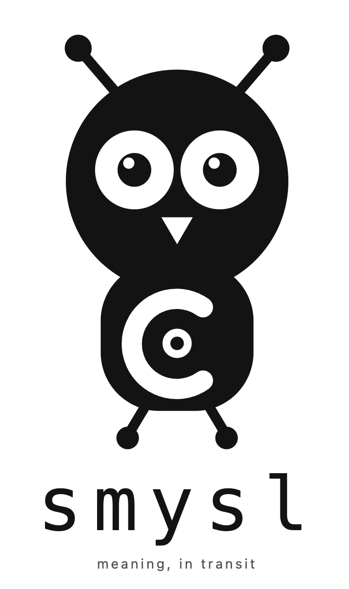

# smysl

**One format that both AI systems and people can read, write, and trust.**

[](https://github.com/vulogov/smysl/actions/workflows/ci.yml)


[](LICENSE)

---

## Getting it

**On crates.io.** Twenty crates: the facade, plus the nineteen behind it that exist so the
compiler can check that the pure set stays pure. The evaluation harness stays unpublished — its
tests read `fixtures/corpus` from outside its own package root, so a published copy would ship
tests nobody could run.

```sh
cargo install smysl                       # the CLI
cargo install smysl --features tui        # …with the terminal browser as well
```

As a library:

```toml
[dependencies]
smysl = "1.18"
```

Add `default-features = false` for the pure library: no async runtime, no HTTP client and no
argument parser in the dependency tree, verified in CI on every push rather than promised
here.

**The crate is `1.18.0` and the format is `smysl/1.0`.** The crate version means the API is
frozen: every public item moves only with a 2.0, enforced per crate by `cargo-semver-checks` on
every push. [`Documentation/API_CONTRACT.md`](Documentation/API_CONTRACT.md) is that promise
written down. The format version means nothing about the format changed incompatibly:
`smysl/0.1` held across fourteen releases and four independent implementations — the Rust, and
Python, JavaScript and Go written from the specification alone — and `smysl/1.0` reports that
record rather than a change. SMYSL-2's library records and SMYSL-3's `x.tel/v1`, at revision 2 since 1.18, are additions a
1.0 reader skips.

## Release 1.18.0

Two RFCs, each built to its last phase: SMYSL-4, Bund2 scripts over a library, and SMYSL-5,
information measures over telemetry. The kernel did not change. The full account, with every
figure measured, is in [`CHANGELOG.md`](CHANGELOG.md).

- **Programmable queries, in another process.** `smysl bund` runs a Bund2 script, with logic
  and CLP(FD), over a disposable snapshot of a store or a library, and returns a typed value.
  It never links Bund2. The boundary is an operating-system sandbox on macOS and Linux, tested
  in CI by running each attack trusted and then sandboxed.
- **Information measures that replay to the byte.** `smysl tel info` states the entropy of a
  series and of its ordinal patterns, mutual information with lag scans and surrogates,
  divergence between windows, and the entropy of a log stream's templates, as units whose
  recipe and sample digest let `tel check` recompute them.
- **Statistics are evidence.** Rule TI holds an info unit to its shape, a recomputation that
  differs is `SMY-E604`, and rule TQ catches a wrong quote of one in an investigation.
- **Five experiments, on simulated data, and said so.** The estimators' defaults hold, the
  statistics see a decoupling and an oscillation that the level detectors miss, and transfer
  entropy names a direction where there is none too often to be released. GE-I3 on RCAEval's
  real incidents, and every real-data run 1.17 left, are still owed. The registry is 176.

Building from source:

```sh
git clone https://github.com/vulogov/smysl && cd smysl
cargo build --release          # the CLI, at target/release/smysl
```

---

## The problem

When one AI hands work to another, it usually hands over **prose**.

Prose is a bad container. The model that wrote it *had* a structure in mind — this is
solid, that is a guess, this rests on that, these two sources disagree — and then it
flattened all of it into paragraphs. The next model has to guess that structure back from
the text. Then it summarises again for the model after it.

Every hop loses something, and it is always the same things:

- **Hedges vanish.** "The data suggests" becomes "the data shows" becomes "we found".
- **Sources evaporate.** By hop three, nobody can say where the number came from.
- **Disagreement disappears.** Two conflicting findings go in; whichever one the last
  summariser preferred comes out. The conflict is not resolved, just dropped.

The usual fix is a custom JSON schema between each pair of systems. That works for the
machines and locks the humans out: nobody reviews a wire format, so the one place a person
could have caught the drift is the place they cannot see.

## The idea

`smysl` is a single format that is **precise enough for machines and readable enough for
people** — so the same artifact travels the whole chain without ever being translated.

```
   model ──▶ model ──▶ human reviews & edits ──▶ model ──▶ report
     └──────────── the same smysl document throughout ───────────┘
```

No adapter at any hop. The AI writes it, another AI merges it, a person opens it in a text
editor and fixes a line, and the next AI picks it up from there.

## What it looks like

This is a real, complete document. It is also the wire format — there is no separate
"machine version".

```
@doc smysl/0.1 { id: v/f1, intent: incident-brief, roots: [f/root-cause] }

@evidence e/pool-wait { status: measured, source: { kind: metric, ref: "pool.wait_ms{shard=eu-west}", captured: 2026-07-09 } }
~ Pool acquisition wait rose from 2 ms to 310 ms over the same window.

@evidence e/canary { status: measured, source: { kind: metric, ref: "canary.p95", captured: 2026-07-09 } }
~ The 4.2 canary ran the same pool configuration without the regression.

@claim c/pool-saturation { status: inferred, grounds: [e/pool-wait] }
~ The eu-west connection pool is saturated.

@claim c/canary-clean { status: derived, grounds: [e/canary] }
~ The canary rules out a pure configuration cause.

@finding f/root-cause { status: inferred, grounds: [c/pool-saturation, c/canary-clean] }
~ Pool saturation is the leading cause but is not consistent with the canary.

@rel c/canary-clean --rebuts--> c/pool-saturation { weight: 0.6 }
```

You can read that. So can a machine, exactly. Three things are being carried that prose
would have dropped:

- **How sure it is.** `measured` (an instrument recorded it) is a different thing from
  `inferred` (a model reasoned it out). The scale runs `unfounded` → `speculative` →
  `inferred` → `derived` → `cited` → `measured`.
- **What it rests on.** `grounds: [e/pool-wait]` means this claim stands or falls with that
  evidence. Retract the evidence and the tool tells you what else falls.
- **What contradicts it.** The `rebuts` edge is part of the document. The disagreement is
  recorded, not smoothed over.

## Why one shared format is worth it

**Nothing degrades in transit.** A guess cannot quietly become a fact. The rule is
mechanical: a conclusion may never be more certain than the weakest thing it rests on, and
it is checked, not hoped for. Confidence can only go down across hops, never up.

**Summarising costs nothing.** Fitting a document to a token budget is ordinary
computation over the graph, not another model call:

```bash
$ smysl --format surface pack --budget 8k --focus c/pool-saturation incident.smy
```

Same input, same budget, same bytes out — every time, on any machine, for free. If a claim
is included, its rebuttals come with it; a budget too small to hold both **fails** rather
than shipping the claim without the objection to it.

Measured over the eight-fixture corpus at 60% of full detail, across five handoffs: tokens
fall to **0.24–0.60** of the whole while **every unit survives on five of six** fixtures.
The saving is bodies dropping to gist, not claims being discarded. `cargo test -p
smysl-eval` reproduces it, without calling a model.

**And measured against the alternative.** The same fixture through five prose handoffs, a
real model summarising at each one, judged by a model that is shown a claim and a passage
and asked what the *passage* supports:

| Five hops, 5 fixtures × 2 models | Tokens | Claims kept | Hedges lost | Sources kept |
|---|---|---|---|---|
| control — no summarisation | 1.00 | 90 / 90 | **0 / 90** | **50 / 50** |
| prose baseline | 0.29 | 72 / 90 | **42 / 90** | **1 / 50** |
| smysl | 0.49 | 90 / 90 | **0 / 90** | **50 / 50** |

Ten runs: F1–F5 through `gemini-3.5-flash-lite` and `deepseek-chat`, 90 claims in total. The
two models agree closely, which is the point of running two — one model's habits are
indistinguishable from a property of the format when there is nothing to compare them
against.

**The prose chain compresses harder** — 0.29 against 0.49 — and pays for it twice. Forty-two
of ninety surviving claims came out reading as *measurements* when the original called them
inferred, cited or derived. And of the fifty claims that named where they came from, **one
survived**. A guess arriving as a finding, and a number nobody can trace, are the two
failures this format exists to prevent; both are visible here at scale rather than as
anecdote.

On the smysl side neither is luck. Confidence is a field that rule M checks; the source is a
field that travels with anything that travels. Nothing is preserved by good behaviour.

Read it with its limits: two models, five fixtures, one run each — enough to say the effect
is not one model's quirk, not enough to put an error bar on it. The control row is what makes
it worth anything at all. The baseline prose states every hedge *and every source* in words,
and the same judge recovers all of them before any summarisation — it abstained on none of
the ninety — so the losses after five hops are the chain's, not the instrument's. The live
test refuses to report any row whose control does not clear. `make eval-live` reproduces it.

**People stay in the loop without a special tool.** The review artifact *is* the document.
No dashboard to build, no viewer to install — open it, read it, change a line, save it.
A human correction is a first-class edit, not a bug report filed against a pipeline.

**Many agents can work at once.** Merging two documents is a set union with no coordinator
and no locking, and it does not matter what order they arrive in. Where two agents disagree,
merge **records the contention** instead of picking a winner.

```bash
$ smysl merge agent-a.smy agent-b.smy -o combined.cbor
agent-b.smy: contention k/ccm3actwjjti65famnoe6mapo5d over b3:cvhirtgs2mpvli2ethhyeo32uf (2 positions, live-rebuttal)
```

This works because a unit's real identity is a hash of its content, not its position in a
file. Two agents that independently record the same fact produce the same identifier and
merge into one unit, with no registry and nobody assigning ids. Names like
`c/pool-saturation` are local nicknames for reading and writing; `b3:…` is the identity
that survives merging.

**Every answer can be traced.** Ask where a conclusion came from and get the actual chain,
because the chain was carried rather than reconstructed.

```bash
$ smysl trace b3:cvhirtgs2mpvli2ethhyeo32uf --grounds incident.smy
b3:cvhirtgs2mpvli2ethhyeo32uf (root)
  b3:izyuzlt42mqcvgdfb4nfpllxyq (grounds)
incident.smy: 2 unit(s) over 1 step(s)
```

## Libraries of texts (SMYSL-2)

Since 1.10, smysl also holds the texts that claims are drawn from: Bibles, books, notes, chat
exports. A text goes into a **library** by a reader, and every byte keeps an identity:

- a part's text is a **tid**;
- the reader's segment table over it is an **rdid**;
- the catalog entry is a **mid**.

So a claim can cite the exact bytes it came from, and a reprint under another title is
recognised as the same text.

```bash
$ smysl text add notes.md --reader md/1 --alias notes --lang en --licence CC0-1.0 -s lib
manifest  m3:bm7kj77dhl7k4fbbuoudll5pmc7wj4yyx4rlxja45nbtfjbwa2rq
alias     notes
reader    md/1
parts     1
  part 0  t3:y2hmm7kwc4xlhqekmjufjyqkvug2ore3q55wodazon53nwt4wulq

$ smysl text add telegram.json --reader telegram/1 --alias team-chat --lang en \
      --licence CC0-1.0 --pseudonymise -s lib
$ smysl measure T1 --scope 'from texts' --min-n 50 --allow-lossy lib
T1 v2  b3:xtttcky3rharshgpuw6qwk4akg  new
  T1 unigram entropy, Miller–Madow 6.1675 bits/token, over from texts
```

What the library layer adds:

| | |
|---|---|
| **Readers** | `txt`, `md`, `usfm`, `osis`, `zefania`, `json`, `telegram`, `slack`, `whatsapp`; speakers pseudonymised under a key; parts cut by policy; `text append` for a grown chat |
| **Ingest over texts** | `ingest --text`: windows over a reading, two consensus passes with their agreement recorded, quotes attached to byte spans, reply edges |
| **Time** | `date set/order/show`: EDTF datings and Allen relations, effective time under rule E, locks and their review |
| **Propositions** | `same-as` engines and strict classes; `link` for entails and contradicts; `summarise` |
| **Queries** | `q`, sq/1: scopes (`from texts`, `from channel:…`), `find`, `about entity(…)`, time on said/observed axes, `expand … only`, sets, saved queries that rerun; `ask` for a dossier |
| **Measures** | `measure`: text (entropy, compression, Zipf, n-gram surprisal, divergence), graph, channel and dialogue measures as reproducible `@data` units; `assess` |
| **Exchange** | `lib export/import/verify`, with the P1 and P3 properties checked; `text redact` |
| **Scale** | sharded libraries, the redb unit store, a persistent postings index |

The design is RFC SMYSL-2, in [`Documentation/SMYSL-2_RFC/`](Documentation/SMYSL-2_RFC/):
nine documents, an index and a roadmap whose phases TX-P0 to TX-P13 are complete.

## Telemetry (SMYSL-3)

Since 1.17, smysl also holds what an incident investigation is made of: what changed in the
cluster, what the metrics, traces and logs said, and what someone concluded from them. Behind
the facade's `tel` feature:

```sh
cargo install smysl --features tel
```

| | |
|---|---|
| **Snapshots** | `tel read k8s/1` and `zabbix/1`: one snapshot per object, change and recreate units by a canonical diff |
| **Series** | `tel read prom/1`, `otlp/1`, `otlp-json/1`, `zabbix/1` history into the series substrate; `tel at`, the value in force at an instant |
| **Evidence** | `tel window`: exact or sketched summaries whose uid is a digest of the samples; rule TW; `tel check` |
| **Detectors** | `tel detect`: CUSUM, PELT, robust z, episodes, a BARO-style ranking |
| **Investigations** | `tel investigate`: hypotheses, probes, actions, what was consulted; rule TQ on numeric quotes; the `timeline` thread |
| **Instruments** | `tel declare`, `tel witnesses`: lineage, and how many independent instruments saw a quantity |
| **Traces and logs** | `tel trace`, `tel templates`, `tel similar`: spans, Drain templates, MinHash over episodes |
| **Retention** | `tel evict`, and `lib export --with-substrate` |
| **Information** | `tel info` (1.18): `ent/1`, `perm/1`, `mi/1`, `jsd/1`, `tent/1` as `x.tel/info` units, recomputed by `tel check` |

The design is RFC SMYSL-3, in
[`Documentation/SMYSL-3_RFC/`](Documentation/SMYSL-3_RFC/SMYSL-3_TELEMETRY.md); its phases
TL-P1 to TL-P9 are complete. The information measures are RFC SMYSL-5, in
[`Documentation/SMYSL-5_RFC/`](Documentation/SMYSL-5_RFC/SMYSL-5_TELEMETRY_INFORMATION.md).

## Bund2 queries (SMYSL-4)

Since 1.18, a Bund2 script can query a store or a library: its `smysl.*` words, logic and
CLP(FD), run in a separate `bund2` process over a disposable snapshot. Behind the facade's
`bund` feature, with a `bund2` built with its `smysl` feature on the path:

```sh
cargo install smysl --features bund
smysl bund -s fixtures/corpus/F1-incident.smy \
  --eval ':lib var? "from library" smysl.kb [ [ unit U claim S ] [ gist U G ] ] kb.query'
```

Scripts run sandboxed unless `--trusted`, and a platform without the sandbox refuses them. The
design is RFC SMYSL-4, in
[`Documentation/SMYSL-4_RFC/`](Documentation/SMYSL-4_RFC/SMYSL-4_BUND2_BRIDGE.md); its phases
BQ-P1 to BQ-P4 are complete.

## Getting content in

Existing prose gets converted by a model — the one place a model is required:

```bash
$ smysl ingest report.md
7 unit(s) staged in ./.smysl/staged.smy; review, then `smysl merge --staged`
```

Three safeguards apply at that boundary, because a model's output is a proposal rather
than a fact:

- **It cannot overstate itself.** A model reading a document may claim at most "cited". If
  it says `measured`, it is downgraded and told so.
- **It cannot fail silently.** A passage the model mangles is kept verbatim as opaque text
  and flagged, so a partial result is still usable.
- **It cannot write straight into your data.** Output lands in a staging file for you to
  read first. `merge --staged` is your confirmation.

Model access is off unless you configure it. `--offline` refuses to open a socket at all,
and `providers --tasks` tells you in advance which commands would leave the machine. API
keys are never stored in config — only the name of an environment variable or a command
that returns one.

## Everything else is deterministic

Only `ingest` and `attest` consult a model. Selecting, merging, ordering, ranking and
rendering are pure functions — same input, same output, byte for byte, verified in CI:

| Command | What it does |
|---|---|
| `check` | Validate a document and explain what is wrong |
| `merge` | Combine documents; record disagreements |
| `pack` | Fit to a token budget without calling a model |
| `thread` | Order a graph into a readable narrative |
| `render` | Emit Markdown, HTML, Typst and more |
| `trace` / `diff` | Follow provenance; compare two versions |
| `salience` | Rank what matters, with the arithmetic shown |
| `retract` | Remove a claim and report the blast radius first |
| `review` / `withdraw` / `resolve` | List open disagreements; withdraw an edge; record a review |
| `ui` | Browse a store; watch the budget bind, live |
| `text` / `lib` | Add, append, show and redact texts; export and import a library |
| `q` / `measure` | Query with sq/1; compute measures as reproducible data units |
| `date` / `same-as` | Date things and solve effective time; propose same-as classes |

`smysl ui` is worth a minute if the packing rules seem abstract. Pin a claim with `f`,
hold `-`, and watch which units survive and why — until the budget drops below the floor
and packing refuses outright rather than shipping a claim without the rebuttal that
answers it:

```
INFEASIBLE
The mandatory floor needs 46 tokens; the budget is 0.
```

## Quick start

```bash
$ cargo build
$ ./target/debug/smysl check fixtures/corpus/F1-incident.smy
fixtures/corpus/F1-incident.smy: 13 records, 8 units, 0 diagnostic(s)

$ ./target/debug/smysl --format surface pack --budget 200 --explain fixtures/corpus/F1-incident.smy
b3:cvhirtgs2mpvli2ethhyeo32uf @L0  -  earned on density
b3:phsoomklkmlq3sjvbe6cyuqy5v @L0  C3  rebuts b3:cvhirtgs2mpvli2ethhyeo32uf
b3:xkys7j42mcuyiaxiyh73xddimr dropped: low-value
fixtures/corpus/F1-incident.smy: 7 of 8 unit(s), 193 of 200 tokens, greedy mode, gap 0.011
```

Read the middle line: that unit was kept **because** it rebuts one that was kept. The
selection cannot quietly drop an objection to something it is showing you.

Two flags worth knowing. `--format surface` prints readable text; output defaults to CBOR,
which is what you want in a pipeline and not in a terminal. `--explain` goes to stderr, so
the reasoning never contaminates the data on stdout — above, the packed document itself is
on stdout and elided here.

Ingest needs a model. [Ollama](https://ollama.com) runs locally, costs nothing, and never
leaves the machine:

```bash
$ ollama serve && ollama pull llama3.2
$ smysl providers --probe
$ smysl ingest notes.md
```

## Using it as a library

The library is the product; the CLI is its first consumer. Nothing the CLI does is
unreachable from the library.

```toml
[dependencies]
smysl = { version = "1.14", default-features = false }                      # pure
smysl = { version = "1.14", default-features = false, features = ["stage"] } # + staging, no model
```

With default features off you get a fully synchronous library — no async runtime, no HTTP
client, no argument parser anywhere in the dependency tree. That is verified in CI rather
than merely intended. Determinism is part of the API: making `pack`, `merge`,
`derive_thread`, `salience` or `render` non-reproducible is a breaking change whatever the
signature says.

Two runnable programs show the API in use: `cargo run --example simple_demo` for the format,
and `cargo run --example information_theory` for the library layer. See
[`examples/`](examples/).

## Status

Crate `1.18.0`, format `smysl/1.0`, kernel `smysl.kernel/0.1`. The contract is
[`Documentation/SMYSL_FORMAT_SPEC.md`](Documentation/SMYSL_FORMAT_SPEC.md) — everything a
second implementation must obey, and nothing else.

RFC SMYSL-1 is retired. It was the product idea, written before there was an implementation;
building it produced 69 places where it was silent or self-contradictory, each decided in
code and recorded in [`Documentation/RFC_PROPOSAL.md`](Documentation/RFC_PROPOSAL.md). Those
decisions are folded into the spec, which is normative in its place.

| Phase | Delivers | State |
|---|---|---|
| SM-P0 – P2 | scaffold, deterministic CBOR codec, surface syntax, `fmt` | **done** |
| SM-P3 – P4 | store, index, adjacency, check passes, `check` | **done** |
| SM-P5 – P6 | trust rules, merge, contentions, retraction | **done** |
| SM-P7 – P8 | lineage (`diff`, `trace`, `view`, `bundle`), salience | **done** |
| SM-P9 – P10 | budget packing, provably optimal mode | **done** |
| SM-P11 – P12 | thread derivation, render IR, six backends | **done** |
| SM-P13 – P14 | provider layer, ingest boundary, `attest` | **done** |
| SM-P15 | corpus F1–F8, evaluation harness (both arms), TUI, `ui` | **done** |

RFC SMYSL-2 — libraries of texts — is built in the same way: phases TX-P0 to TX-P13 are
complete, every open question on the release path is decided, and the decisions are recorded
in the RFC set beside the measurements that made them.

| Phase | Delivers | State |
|---|---|---|
| TX-P0 – P2 | hardening, format amendment (records 14–19), parts, readings, manifests, readers, segmenter, pseudonyms, redaction, proposition classes | **done** |
| TX-P3 – P4 | EDTF and datings, the rule E time engine and locks, the substrate index, `text` commands | **done** |
| TX-P5 – P7 | ingest over texts with consensus extraction, sq/1, same-as engines, linker, summary tree | **done** |
| TX-P8 – P9 | dossiers, saved queries, text, graph, channel and dialogue measures, `assess` | **done** |
| TX-P10 – P13 | semantic retrieval, export and import, lenses and `migrate`, scale (shards, redb) | **done** |

RFC SMYSL-3, telemetry, is built to its last phase. Its experiments ran on simulated data and
say so; the runs on real data, and GE-M7 on agents, are owed.

| Phase | Delivers | State |
|---|---|---|
| TL-P1 – P3 | `dec`, `x.tel/v1`, snapshots and the canonical diff, the series substrate and its readers | **done** |
| TL-P4 – P5 | window evidence, rule TW, detectors | **done** |
| TL-P6 – P7 | investigations, rule TQ, kinds 6 and 7, the timeline thread, instruments and witnesses | **done** |
| TL-P8 – P9 | retention and exchange, traces and logs, similar episodes | **done** |
| AC-8 | a store's check kept as derived state | **done** |

RFC SMYSL-4, Bund2 queries, and RFC SMYSL-5, information measures, are built to their last
phases. SMYSL-5's experiments ran on simulated data; GE-I3 on RCAEval is owed.

| Phase | Delivers | State |
|---|---|---|
| BQ-P1 – P4 | `smysl-bund`: the word gate, the decoder, the runner, the sandbox, `smysl bund` | **done** |
| TI-P0 – P2 | `x.tel/v1` revision 2, `ent/1`, `perm/1`, `mi/1`, `jsd/1`, `tel info` | **done** |
| TI-P3 – P4 | `tent/1`; rule TI, recomputation in `tel check`, statistics in investigations | **done** |
| TI-P5 | transfer entropy: not released, by GE-I5 | **closed** |

Model providers, and how far each has actually been proven — an untested mapper is a
reading of a vendor's documentation, not a fact about their API:

| Provider | State |
|---|---|
| Ollama (local) | verified against a running server |
| DeepSeek | verified against the live endpoint |
| Gemini | verified against the live endpoint |
| Anthropic | verified against the live endpoint |
| OpenAI | implemented, but not tested |

Anthropic and OpenAI were read against their vendor documentation — which found two real
defects — and then, in 1.15, a key confirmed the Anthropic endpoint accepts what we send, once
the mapper had been moved to the current models (a forced tool choice is refused there; the
tool is strict instead). No OpenAI key has been available. The concrete mappers are not part of
the public API, so a wrong one is fixable without a 2.0. **If you have an OpenAI key, running
that live test is the most useful contribution available.**

That distinction has already earned its keep. Gemini's support was written from the
documentation, which describes its response schema as a subset of JSON Schema draft
2020-12. It is not one, so every structured call was refused until a live key proved it —
and no recorded test fixture could have caught that.

## Layout

```
src/                   facade crate: [lib] + [[bin]] smysl
crates/smysl-core      kernel types, deterministic codec, surface syntax, diagnostics
crates/smysl-graph     append-only store, index, adjacency, merge, salience
crates/smysl-check     the ten check passes
crates/smysl-pack      budget-bounded, closure-complete selection
crates/smysl-thread    thread schemas and deterministic derivation
crates/smysl-render    render IR, profiles, backends
crates/smysl-provider  the model boundary - the only crate linking a runtime
crates/smysl-ingest    staging, repair, trust ceiling, recipes
crates/smysl-retrieve  lexical retrieval: analyzers, BM25, postings
crates/smysl-embed     semantic retrieval (feature `semantic`)
crates/smysl-embed-candle  transformer embeddings (feature `semantic-candle`)
crates/smysl-text      SMYSL-2 library: readers, parts, readings, time, substrate index
crates/smysl-query     sq/1: parser, planner, executor, saved queries, dossiers
crates/smysl-measure   text, graph, channel and dialogue measures; assessment
crates/smysl-lib       library export, import and verify
crates/smysl-tel       SMYSL-3 telemetry: readers, diff, evidence, detectors, investigations
crates/smysl-series    SMYSL-3 series substrate: samples, window digests, chunks
crates/smysl-bund      SMYSL-4 Bund2 bridge: word gate, snapshot, runner, sandbox
crates/smysl-tui       seven-pane terminal UI, with a live pack simulator
crates/smysl-eval      evaluation harness E1-E9 (not published)
examples/              simple_demo and information_theory
python/ go/ nodejs/    independent implementations, written from the spec
fixtures/              corpus, conformance suite, golden artifacts
xtask/                 purity and determinism gates
```

## Building and testing

```bash
cargo build                       # cli + tui + local (Ollama) + Typst rendering
cargo build --no-default-features # pure library: no runtime, no HTTP, no arg parser
cargo test --workspace --all-features
```

Two gates run in CI and are worth running locally, because both check properties that
lapse silently rather than loudly:

```bash
cargo xtask check-purity   # the library stays synchronous and offline
cargo xtask determinism    # pure operations are bit-reproducible
```

No panics on untrusted input is checked two ways: a deterministic mutation sweep in
ordinary CI, and `cargo fuzz` targets under `fuzz/` for the surface parser and the CBOR
reader.

```bash
cargo +nightly fuzz run surface
```

## Licence

MPL-2.0.
